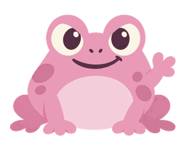

<p align="center">
  &nbsp;&nbsp;
</p>

## What is Frogphony?

Frogphony is a browser-based music learning project. It brings ear training, music theory and general music knowledge into one place, with short interactive lessons instead of pages of passive reading.

It's an **early demo**, not a finished course. The current version has three playable lesson sets, a practice mode and a small progress system. The interface is in Polish.

| | In the current demo |
| :--- | :--- |
| **Ear training** | Listen to generated notes and identify intervals. |
| **Music theory** | Practice chords and key signatures through short questions. |
| **Music knowledge** | Explore instruments and composers. |
| **Feedback** | See the correct answer and a short explanation. |
| **Progress** | Earn XP and track completed lessons in your browser. |

No account is needed. Progress is stored locally on the device, not synchronized between browsers.

## Meet Kumka

Kumka is Frogphony's pink toad mascot. The character appears throughout the learning interface.

The repository also contains a separate [Rive animation experiment](design/kumka-rive/) with idle, wave, success and encouragement motions. **The web app currently uses static mascot artwork**; the Rive runtime animation has not been integrated.

## Run locally

Requires **Node.js 22.13+** and npm.

```bash
git clone https://github.com/midasracing/frogphony.git
cd frogphony
npm install
npm run dev
```

The development server prints the local address. To build and preview the production version:

```bash
npm run build
npm run preview
```

| Technology | Used for |
| :--- | :--- |
| React 19 + TypeScript | Interface and lesson logic |
| Vite 8 | Local development and production builds |
| Web Audio API | Synthesized exercise tones |
| localStorage | Device-local learning progress |
| GitHub Actions + Pages | Static deployment |

The app is deployed from `main` via [GitHub Actions](.github/workflows/pages.yml). Vite uses `/frogphony/` as its base path for GitHub Pages.

## Project structure

```text
frogphony/
├── src/
│   ├── App.tsx            # Lessons, practice, progress and navigation
│   ├── styles.css         # Responsive interface
│   └── main.tsx           # App entry point
├── public/
│   ├── kumka.png          # Mascot artwork
│   └── animations/        # Rive runtime asset (not yet wired into the app)
├── design/kumka-rive/     # Editable animation source and build scripts
└── .github/workflows/    # GitHub Pages deployment
```

## What's next

The prototype establishes the interface and core lesson flow. The next steps are:

- More lessons across all three subjects.
- Better audio examples, including verified instrument samples.
- Automated tests for exercises and progress.
- Integrating Kumka's Rive animation after runtime compatibility is verified.
- Continued accessibility and small-screen improvements.

The audio in the current demo is **synthesized**, not a recorded piano. The three lesson sets are examples, not a complete curriculum.

## Contributing

Bug reports, accessibility improvements, lesson corrections and well-scoped pull requests are welcome. Read [CONTRIBUTING.md](CONTRIBUTING.md) before opening a PR.

If you want to suggest a lesson, include the learning objective, an example question, the correct answer and a short explanation. Accuracy matters more than the number of exercises.

## License and assets

Original source code in this repository is licensed under the [MIT License](LICENSE).

**Kumka artwork, character designs and derivative animation assets are excluded from the MIT grant.** See [ASSETS.md](ASSETS.md) before reusing any visual assets. Third-party dependencies retain their own licenses.

---

<div align="center">

  <sub>Built in public by <a href="https://github.com/midasracing">midasracing</a> · <a href="https://midasracing.github.io/frogphony/">Open Frogphony</a></sub>

</div>

## Animated mascot (Rive)

The animated Kumka is rendered by `@rive-app/react-webgl2` in `src/Kumka.tsx`, using the native file at `public/animations/kumka.riv`. It runs the `KumkaController` state machine on the `Kumka` artboard, with ViewModel triggers `blink`, `look`, `wave`, `success` (the schema is documented in `design/kumka-animation/rig-manifest.json`).

Click Kumka on the home screen to wave. In practice questions, correct answers trigger celebration, and incorrect answers trigger a look; the finishing screen also celebrates. If Rive hasn't loaded, the approved `kumka.png` is displayed instead.

The Rive asset was built locally with the Rive CLI and may need a signed publish/export if a particular Rive web runtime refuses the binary. Verify on the deployed GitHub Pages site. All asset URLs use Vite's `import.meta.env.BASE_URL` to work under the repository subpath.
